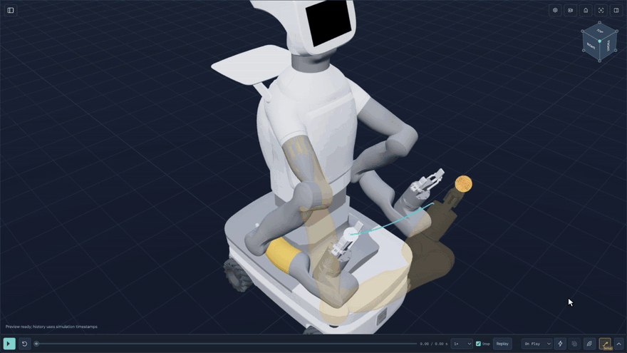

# TIAGo MPC visualizer

> [!CAUTION]
> **This is an agent-generated, experimental visualizer for my thesis project,
> [tiago_mpc](https://github.com/felixmueh/tiago_mpc).** Go to that main
> project for the overview, instructions and general usage.
>
> The code in this repository has not been carefully reviewed. It is a fun
> experiment with agentic coding, not a maintained tool.

The visualizer is a local browser application around `tiago_mpc`'s torque MPC
for the TIAGo Pro right arm. It runs the reaching and figure-eight tasks in
simulation and shows the full robot in 3D, with the predicted tool path, solver
statistics and plots, while you change MPC settings, targets and obstacles. It
also replays and compares saved runs and exports animations. It only simulates:
it never commands a physical robot.



## Setup

You need everything `tiago_mpc` needs (Linux, an NVIDIA GPU with CUDA 12.x,
Git LFS and uv) plus Node.js 20.19 or newer with npm.

1. Clone and set up `tiago_mpc` next to this repository, as described in its
   README, and run its minimal example once to check the installation:

   ```bash
   git lfs install
   git clone https://github.com/felixmueh/tiago_mpc.git
   cd tiago_mpc
   git lfs pull
   uv sync
   uv run python -m experiments.minimal
   cd ..
   ```

2. Clone this repository beside it and compile the MPC modules for the default
   horizons (N = 16, 32, 64 and 128). This takes several minutes:

   ```bash
   git clone https://github.com/felixmueh/gato_visualizer.git
   cd gato_visualizer
   ./scripts/start.sh --prebuild --mpc-root ../tiago_mpc
   ```

## Run

```bash
./scripts/start.sh --mpc-root ../tiago_mpc
```

Then open <http://localhost:8090>. The launcher installs the frontend
dependencies on first start, builds the frontend and serves everything from one
process. It uses `tiago_mpc`'s own `.venv` and installs no Python packages.
Add `--host 0.0.0.0` to reach it from other machines on your network, and
`--port` to change the port. Instead of `--mpc-root` you can set
`TIAGO_MPC_ROOT`, or select the checkout in the app under
**Settings › Backend**, which also builds modules for other horizons.

Detailed, unreviewed notes on usage and development are in
[docs/user-guide.md](docs/user-guide.md). They were written for my own setup
and may be out of date.
