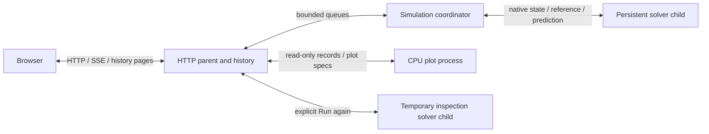

# Architecture and continuation guide

The application is a local simulation and inspection diagnostic. It imports
`tiago_mpc`'s model (`tiago_mpc.tiago`), MPC (`tiago_mpc.mpc`: `MpcParams`,
`find_binary`, `compile_binary`, `Mpc`) and plant (`tiago_mpc.sim.SimPlant`)
unchanged and owns browser interaction, execution scheduling and retained
history. Read [AGENTS.md](../AGENTS.md) for
project constraints and [the glossary](../UBIQUITOUS_LANGUAGE.md) for domain terms.
[README.md](../README.md) contains startup, prepared-environment/source selection,
cache/build policy and user workflows.

## Process ownership



`server.py` wires the services. The HTTP parent drains numerical output and
retains every committed record before publishing latest-value notices. It also
renders FK for those records; it owns no live controller/CUDA objects. The
simulation coordinator owns native plant state/time, the `SimPlant` it steps and
the GPU leases; it imports no compiled GATO module. Its persistent solver child
holds `tiago_mpc`'s `Mpc(params, find_binary(params))` and its private warm state,
using the selected profile's interpreter. Normal solves reuse that child.
CPU plotting loads committed sources independently. Explicit Run again pauses
Live at a committed boundary and uses a separate temporary solver child; only
one GPU computation runs at a time. Live's private controller remains idle.

## Where to change what

| Area | Main source files | Contract |
| --- | --- | --- |
| HTTP, scene/model/FK, service wiring | [server.py](../server.py) | [Live payloads](live-api.md) |
| History, generations, SSE publication | [execution_bridge.py](../execution_bridge.py), [execution_worker.py](../execution_worker.py) | [Execution/history](execution-api.md), [reporting](presentation.md) |
| Simulation clocks, held torque, interval costs | [execution_session.py](../execution_session.py), [solver_adapter.py](../solver_adapter.py) | [Execution](execution-api.md) |
| `tiago_mpc` import, settings schema and validation, reference geometry, GPU locks | [live_mpc.py](../live_mpc.py) | [Live settings/tasks](live-api.md) |
| Solver RPC, native conversion, leases, child lifetime | [solver_process.py](../solver_process.py), [solver_worker.py](../solver_worker.py), [solver_lifecycle.py](../solver_lifecycle.py) | [Solver profiles](solver-profiles.md) |
| Source/interpreter/cache selection, source probe (`find_binary`) and explicit builds (`compile_binary`) | [source_runtime.py](../source_runtime.py), [source_settings.py](../source_settings.py), [visualizer_config.py](../visualizer_config.py), [scripts/source_probe.py](../scripts/source_probe.py) | [README source setup](../README.md#run) |
| Run again, exact captured problem, binary SQP trace | [solve_inspections.py](../solve_inspections.py), [inspection_problem.py](../inspection_problem.py), [inspection_worker.py](../inspection_worker.py), [inspection_artifacts.py](../inspection_artifacts.py) | [Inspection](inspection.md) |
| Plot jobs, source views, standard plots | [plot_service.py](../plot_service.py), [plot_sources.py](../plot_sources.py), [gato_visualizer/plotting/](../gato_visualizer/plotting), [plotters/standard.py](../plotters/standard.py) | [Plot API](plot-api.md), [author workflow](plot-authoring.md) |
| NPZ validation, watched library, uploads | [replay_format.py](../replay_format.py), [replay_library.py](../replay_library.py) | [Replay/export cookbook](replay-format.md) |
| Browser scene and interaction wiring | [src/main.js](../src/main.js), [src/workbench-ui.js](../src/workbench-ui.js) | [README workspace](../README.md#workspace) |
| Browser Live history, playback, settings | [src/live.js](../src/live.js), [src/live-history.js](../src/live-history.js), [src/live-execution.js](../src/live-execution.js), [src/presentation-settings.js](../src/presentation-settings.js) | [Execution](execution-api.md), [presentation](presentation.md) |
| Episode/Solve selection and shared plot rendering | [src/plot-inspection.js](../src/plot-inspection.js), [src/plot-state.js](../src/plot-state.js), [src/solve-run.js](../src/solve-run.js), [src/plot-renderer.js](../src/plot-renderer.js) | [Inspection](inspection.md), [plotting](plotting.md) |

Production Live uses `SimulatorAdapter`, the solver child and
`MultirateSession`; `scripts/check_conformance.py` compares exactly that path
with `tiago_mpc`'s `experiments.reach.reach`. `LatestPresentation` and `src/live-playout.js` retain older
presentation helpers; the current motion clock is `createHistoryClock` in
`src/live-execution.js`, driven by fetched history. Do not infer production
ownership or playback timing from an old helper alone.

## Invariants to preserve

Simulation, control and TO frequencies are independent of prediction knot
spacing and wall-clock report frequency. At coincident numerical boundaries,
solve first, select the control, then integrate. Every plan and completed
deadline interval is retained, and with `record_every` 1 every integration
endpoint and control change; larger values thin only those two ([recording
substeps](execution-api.md#recording-substeps)) and never change the simulation. A slow solve
slows wall-clock progress; it does not advance plant time. Live defaults to
20 Hz reports, a 200 ms simulation-time playback buffer and sample hold.
Changing these presentation preferences does not reset settings, generation or
controller state. See [presentation.md](presentation.md) for packet/page limits.

Only native coordinates cross the ordinary solver RPC boundary: a plan is
`tiago_mpc`'s `Plan`, N knot states (q, qd) and N−1 knot torques, with no
terminal torque. `Mpc` applies the joint-6 GPU signs; the child applies them
itself only for controller reset, installed bound rows and inspection. Legacy
raw XU and inspection arrays retain their own signs; portable NPZ already
contains native coordinates. All displayed positions use the full robot root
frame derived from the URDF. The simulator friction switch (`plant.friction`)
gives `SimPlant` the URDF friction (hard-sign Coulomb plus viscous) or none;
predictor/profile changes do not change the plant. Predictor friction
(`friction` in `MpcParams`) selects a compiled variant with a fixed tanh width.
Both default to loss-free. See [friction](friction.md).

A generation identifies active history, a settings version identifies the
accepted settings, and cancellation revision rejects obsolete work. Changing
execution settings captures displayed q, qd and task time once for a new segment.
Ordinary Play extends the history tip. Pinning fixes solve/iteration selection;
it does not pause the episode. Exact optimizer continuation is unavailable.
Run again is cold, separate and explicit; inspection Stop terminates only its
isolated child and supplies no partial checkpoint. Ordinary Pause is cooperative.

Saved source/interpreter/cache selection controls imports. Source Apply restarts
the backend; a Build into the active solver's own checkout, interpreter and cache
only refreshes the available N (`ProcessLiveService.refresh_compiled`); profile
activation replaces only the solver and starts a new segment.
Neither ordinary settings nor profile activation compiles: `Mpc(params, binary)`
only loads. Build selected N is the explicit build path; it calls `compile_binary`
into the selected project cache. Logs, binary traces
and local history belong in this checkout's ignored `_expr_data/`; the shared
ingest directory contains portable replay handoffs only. See AGENTS for storage
exceptions and preservation rules.

## Verification

Choose existing checks for the area changed; documentation-only changes need
link/contract review, not GPU runs. From the checkout root, resolve the prepared
interpreter without installing packages:

```bash
python_bin="$(python3 scripts/launch_python.py)"
```

| Change | Focused CPU/browser checks |
| --- | --- |
| Scheduling, anchors, cancellation | `"$python_bin" -m unittest discover -s tests -p 'test_execution.py' -v` |
| Reporting and presentation preferences | `"$python_bin" -m unittest discover -s tests -p 'test_record_batching.py' -v`; `"$python_bin" -m unittest discover -s tests -p 'test_presentation_settings.py' -v` |
| History storage, cursors and HTTP | `"$python_bin" -m unittest discover -s tests -p 'test_history*.py' -v` |
| Solver boundary and profile lifecycle | `"$python_bin" -m unittest discover -s tests -p 'test_solver*.py' -v` |
| Inspection problem/capture/jobs | `"$python_bin" -m unittest discover -s tests -p 'test_*inspection*.py' -v` |
| Source selection/build orchestration | `"$python_bin" -m unittest discover -s tests -p 'test_source*.py' -v` |
| Plot functions, jobs and views | `"$python_bin" -m unittest discover -s tests -p 'test_plot*.py' -v`; [offline CLI checks](plot-authoring.md#offline-checks) |
| Replay validation and export compatibility | `"$python_bin" -m unittest discover -s tests -p 'test_replays.py' -v` |
| Browser logic and bundle | `npm test`; `npm run build` (or `node --test src/live-execution.test.js src/presentation-settings.test.js` for focused playback checks) |

The full CPU suite is `"$python_bin" -m unittest discover -s tests -v`. Tests
that need `tiago_mpc` take it from `TIAGO_MPC_ROOT` (default `../tiago_mpc`) and
need no compiled module; fake adapters exercise process/scheduler behavior
without proving native solver numerics. The opt-in
[GPU conformance command](../README.md#development) compares the production Live
loop with `tiago_mpc`'s own reach for the default loss-free reach only. Native/profile qualifications are bounded by the
actual source, model and horizon checked; no CPU suite establishes all-horizon
GPU equivalence or performance. Retain new native evidence under `_expr_data/`
and coordinate an idle GPU window when such work is authorized and relevant.

## Accepted decisions and limits

- [ADR 001: reuse upstream numerics; own execution clocks](adr/001-upstream-and-clocks.md).
- [ADR 002: isolate solver state and explicit inspection](adr/002-solver-isolation.md).
- [ADR 003: retain all numerical history; batch presentation](adr/003-history-and-presentation.md).

The prototype provides simulated motion, no physical-robot command or collision
qualification, and diagnostic timings rather than benchmark evidence. History
files survive replacement, but there is no historical-generation/branch browser.
Ordinary solves do not retain full incoming optimizer state or intermediate
trajectory traces; missing historical data stays unavailable. These limits are
part of the current contract, not implicit permission to expand scientific scope.
