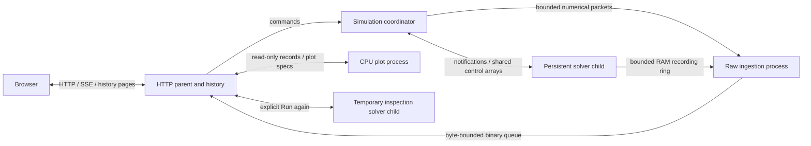

# Architecture and continuation guide

The application is a local simulation and inspection diagnostic. It imports
`tiago_mpc`'s model (`tiago_mpc.tiago`), MPC (`tiago_mpc.mpc`: `MpcParams`,
`find_binary`, `compile_binary`, `Mpc`) and plant (`tiago_mpc.sim.SimPlant`)
and uses its shared `run_virtual_time` loop. It owns browser interaction,
callback gating, reporting and retained history. Read [AGENTS.md](../AGENTS.md) for
project constraints and [the glossary](../UBIQUITOUS_LANGUAGE.md) for domain terms.
[README.md](../README.md) contains startup, prepared-environment/source selection,
cache/build policy and user workflows.

The [solver capabilities plan](solver-capabilities-plan.md) describes the work
needed to expose the remaining controller/dynamics options and migrate to
GATO's cost menu, including the upstream gaps for exact cost curvature and
optimizer inspection/continuation. It is a proposal, not the current contract.

This experimental branch also supports [visualizer-owned settings adapters](source-settings.md):
`adapters/tiago.py` owns standard display metadata and the standard controls
(including the collision rows), with an optional ignored checkout-local override
for local experiments with a modified checkout.
Its friction tests are `tests/test_friction_adapter.py`. This worktree
follows `tiago_mpc` main; older checkouts fail without fallbacks
(AGENTS.md, Felix 2026-11-08).

The shared Live compilation UI uses a read-only selected-interpreter model check
before accepting a draft. Supported N choices are independent of cached N.
The native `find_binary` result is authoritative; the browser never duplicates
cache-key rules. Explicit Compile freezes the complete draft, then rechecks the
latest draft and source/profile/cache identity after completion. See
[the compilation contract](source-settings.md#compiled-models-and-explicit-build).

## Process ownership



`server.py` wires the services. The HTTP parent drains numerical output and
retains every committed record before publishing latest-value notices. It also
renders FK for those records; it owns no live controller/CUDA objects. The
browser consumes a compact companion stream with the same committed cursors;
prediction summaries replace full prediction arrays there. Indexed full-plan
requests fill a bounded browser cache independently of motion playback. Full
server recording and FK work remain unchanged. The presentation contract
defines display-time sampling and exact scrubbing/export behavior.
The simulation coordinator owns native plant state/time, the `SimPlant` it steps and
the GPU leases; it imports no compiled GATO module. Its persistent solver child
holds `tiago_mpc`'s `Mpc(params, find_binary(params))` and its private warm state,
using the selected profile's interpreter. Normal solves reuse that child.
The shared loop submits requests without waiting, integrates the independent
plant interval, then waits only at a possible activation boundary. Control
arrays occupy a preallocated mmap buffer; the private socket carries small
request/result notifications and borrowed GPU leases. Full solve captures use
a separate bounded RAM recording ring. Control-ready notifications precede
capture serialization; reserved recording locators become readable independently.
The child serializes before accepting its next request, preserving diagnostic
ownership. The ingestion process copies raw bytes and frees those slots before
capture deserialization, statistics formatting, FK and JSON in the history
process; stale packets also release their slots. The producer ring and ingestion
queue each default to a 256 MiB budget. See the execution contract for startup
configuration, memory accounting and lossless simulation backpressure. The
coordinator never freezes/thaws whole solve records.
`NativeSession` retains one native loop invocation on a coordinator thread;
ordinary batches enter a bounded queue while execution continues. The owner
reads committed immutable progress snapshots; explicit Pause drains published
batches and parks before result collection, retaining any unread solve. Closing
the coordinator's GPU descriptors leaves outstanding child work holding its leases.
Blocking callbacks gate requested
ends and actual pauses, while a full queue applies lossless backpressure. The native loop owns
request scheduling, activation, command laws and latency prediction. The
visualizer captures detached numerical observations; HTTP-side FK, diagnostic
formatting, history serialization and plotting run outside the solver child.
CPU plotting loads committed sources independently. Explicit Run again pauses
Live at a committed boundary and uses a separate temporary solver child; only
one GPU computation runs at a time. Live's private controller remains idle.
The inspection child creates a fresh MPC for each SQP cap from 1 to the selected
maximum, using one cached module and the same captured problem and cold seed.
It retains each run's final trajectory and actual iteration count; native
per-iteration capture is not required. No native source changes are involved.

The lifetime rules are part of these boundaries:

- The native invocation thread owns evolving plant/controller state. The
  coordinator reads committed `Progress` snapshots and sends gate/cancellation
  requests; it does not inspect partially updated numerical state.
- Pause retains the invocation and any unread solver reply. Cancellation
  wakes and joins it before replacement; reset gets new numerical state.
- A recording locator belongs to the ingestion process after handoff. Stale
  generations still release their slots; shutdown drains or reclaims only the
  stopped producer's storage.
- Browser generation and cursor ownership stays in `live.js`. Paging accepts
  only responses matching its captured generation, cursor and reset epoch.
  Prediction downloads cannot advance motion history or replace its records.

- **Animation export:** the browser freezes visible tracks and renders a separate
  capture scene; the HTTP parent's `AnimationExportService` streams PNGs to a
  CPU ffmpeg child. It uses no simulation or solver process. Runtime jobs are
  removed after download, cancellation, or expiry. See
  [animation export](animation-export.md) for the capture and encoding contract.

## Where to change what

| Area | Main source files | Contract |
| --- | --- | --- |
| HTTP, scene/model/FK, service wiring | [server.py](../server.py) | [Live payloads](live-api.md) |
| Agent CLI and shared-settings controls | [scripts/control.py](../scripts/control.py), [src/backend-watch.js](../src/backend-watch.js) | [Agent API](agent-api.md) |
| Retained records, cursors, compact pages and indexed plans | [history_store.py](../history_store.py) | [Execution/history](execution-api.md) |
| Generation lifecycle, commands and SSE publication | [execution_bridge.py](../execution_bridge.py), [execution_worker.py](../execution_worker.py) | [Execution/history](execution-api.md), [reporting](presentation.md) |
| Native loop observations, callback gate, interval costs | [native_session.py](../native_session.py), [execution_session.py](../execution_session.py), [solver_adapter.py](../solver_adapter.py) | [Execution](execution-api.md) |
| `tiago_mpc` import, settings schema and validation, reference geometry, GPU locks | [live_mpc.py](../live_mpc.py) | [Live settings/tasks](live-api.md) |
| Solver requests, shared buffers, leases, child lifetime | [solver_process.py](../solver_process.py), [solver_exchange.py](../solver_exchange.py), [solver_worker.py](../solver_worker.py), [solver_lifecycle.py](../solver_lifecycle.py) | [Solver profiles](solver-profiles.md) |
| Source/interpreter/cache selection, source probe (`find_binary`) and explicit builds (`compile_binary`) | [source_runtime.py](../source_runtime.py), [source_settings.py](../source_settings.py), [visualizer_config.py](../visualizer_config.py), [scripts/source_probe.py](../scripts/source_probe.py) | [README source setup](../README.md#run) |
| Run again, captured problem, binary capped-solve trajectories | [solve_inspections.py](../solve_inspections.py), [inspection_problem.py](../inspection_problem.py), [inspection_worker.py](../inspection_worker.py), [inspection_artifacts.py](../inspection_artifacts.py) | [Inspection](inspection.md) |
| Plot jobs, source views, standard plots | [plot_service.py](../plot_service.py), [plot_sources.py](../plot_sources.py), [gato_visualizer/plotting/](../gato_visualizer/plotting), [plotters/standard.py](../plotters/standard.py) | [Plot API](plot-api.md), [author workflow](plot-authoring.md) |
| NPZ validation, watched library, uploads | [replay_format.py](../replay_format.py), [replay_library.py](../replay_library.py) | [Replay/export cookbook](replay-format.md) |
| Session state, track rendering and timeline lanes | [src/session.js](../src/session.js), [src/track-scene.js](../src/track-scene.js), [src/expanded-timeline.js](../src/expanded-timeline.js) | [Session and tracks](presentation.md#session-and-tracks) |
| RAM freeze export and motion-only payload | [live_freeze.py](../live_freeze.py), [replay_library.py](../replay_library.py), [server.py](../server.py) | [Freeze contents](replay-format.md#live-freezes) |
| Recorded onion keyframes, ghost arm pool and interaction | [src/onion-skin.js](../src/onion-skin.js), [src/ghost-arm.js](../src/ghost-arm.js), [src/onion-skin-view.js](../src/onion-skin-view.js) | [Onion skin](presentation.md#onion-skin) |
| Browser scene and interaction wiring | [src/main.js](../src/main.js), [src/workbench-ui.js](../src/workbench-ui.js), [src/transport-popover.js](../src/transport-popover.js) | [README workspace](../README.md#workspace), [presentation](presentation.md) |
| Solid arm visibility without hiding ghost clones | [src/arm-visibility.js](../src/arm-visibility.js) | [Session and tracks](presentation.md#session-and-tracks) |
| Viewport start-pose joint rings and grasp translation | [src/joint-editor.js](../src/joint-editor.js), [src/arm-kinematics.js](../src/arm-kinematics.js), [robot_frames.py](../robot_frames.py) | [Viewport start-pose editing](presentation.md#viewport-start-pose-editing), [Live grasp metadata](live-api.md) |
| Live obstacles and collision spheres: viewport drawing and editing, rows adapter, body posture | [src/live-obstacles.js](../src/live-obstacles.js), [adapters/tiago.py](../adapters/tiago.py), [solver_worker.py](../solver_worker.py) | [Live obstacles](presentation.md#live-obstacles-and-collision-spheres), [source settings](source-settings.md) |
| Browser Live history, playback, settings | [src/live.js](../src/live.js), [src/live-history.js](../src/live-history.js), [src/live-execution.js](../src/live-execution.js), [src/presentation-settings.js](../src/presentation-settings.js) | [Execution](execution-api.md), [presentation](presentation.md) |
| Browser history HTTP paging and stale-response rejection | [src/live-history-paging.js](../src/live-history-paging.js) | [Execution](execution-api.md) |
| Prediction display/export selection and bounded downloads | [src/live-prediction.js](../src/live-prediction.js), [src/live-plan-cache.js](../src/live-plan-cache.js) | [Presentation](presentation.md) |
| Episode/Solve selection and shared plot rendering | [src/plot-inspection.js](../src/plot-inspection.js), [src/plot-state.js](../src/plot-state.js), [src/solve-run.js](../src/solve-run.js), [src/plot-renderer.js](../src/plot-renderer.js) | [Inspection](inspection.md), [plotting](plotting.md) |

Production Live uses `SimulatorAdapter`, the solver child and
`NativeSession`; `scripts/check_conformance.py` compares exactly that path
with `tiago_mpc`'s `run_virtual_time` with a `Reach` task. The motion clock is `createHistoryClock` in
`src/live-execution.js`, driven by fetched history over the browser session span,
with the main track owning Live tip decisions. Browser HTTP paging owns only
in-flight/coalesced request state; the Live controller owns its generation,
cursor and reset epoch. Prediction selection is independent of that transport
and can be tested using recorded samples without starting a solver or renderer.
The unused older presentation worker and playout helper have been removed.

The adapter builds `SimConfig(q=..., qd=..., substep=..., integrator=...,
friction=..., friction_law=...).build()` from the native state and starts the plant with
`VirtualClock(sim_time_s)`. Reset and rollback get fresh clocks; numerical time never
moves backward in a plant instance. The source probe checks this lifecycle and
the MPC's `request`/`result` interface before a source can be selected. The
session constructs native `VirtualTimeSettings` and invokes upstream
`run_virtual_time(..., settings=settings, duration=..., ...)` directly.
The native plant integrates its configured substeps up to each command tick.
Live uses a finite maximum duration and relaxes the experiment duration guard
only in its simulation process; conformance supplies a finite test duration.
The settings object owns only command/update periods and solve latency.
Compensation, `ExecutionSafety(max_plan_age_s=...)`, effort handling, callbacks
and lifecycle controls are separate invocation arguments. The source probe
requires the three timing fields, these loop parameters and the safety
validator it uses. Measured solve latency is the
normal default. Conformance uses declared latency (5.5 ms by default) on both
sides. Effort clipping is the native loop's separate effort handling after
command-law evaluation. Laws and effort handlers return native `Command | Fault`,
and handlers receive the complete `Command`. Physics breach events are detected at every substep and
delivered at the next command boundary.
Age expiry is configurable and disabled by default in Live; the finite horizon
still applies, with no implicit final-command hold. See
[execution](execution-api.md#simulation-clock-and-plan-execution).

The visible application has a single session workspace. Startup awaits
`live.ready` before entering it so both available and offline sources share
the same transport. Replay mode is the session's independent `replayOnly` flag;
it does not switch to the hidden legacy Replay workspace. `activeTracks` omits
the retained Live track in this mode, and the session span, lanes and playback
bounds use those active tracks. Add track and library links (`onLinkedItem`)
enter Replay mode; Freeze for comparison stays in Live. Initial `?replay=`
startup skips Live's event subscription and automatic preview.

Entering Replay mode cancels ongoing Live calculation (ordinary Pause does not
cancel Manual/Automatic jobs), clears queued settings submission and blocks new
simulation/preview/settings commands. Live's controls remain visible but inert;
the scene omits its arm, paths and temporal ghosts. The first visible replay
supplies Joints, Episode and follow-cursor Solve; pinned inspection retains its
own source. The stored main track remains Live, with no general focus selector.
The top-centre return button and bottom-bar toggle restore the retained Live
track and all recordings, paused. Replay Reset rewinds the recorded clock.
Hidden legacy Replay DOM/adapters remain for compatibility with existing
inspection and recording code; they expose no second UI transport.

The HTTP parent owns the current accepted Live settings. `task_settings.py`
resolves general defaults, task default overrides and session edits for every
task. General execution defaults come from the source's loop defaults
(`run_virtual_time`'s `settings` and `compensation`; the law's default is
`FrictionFeedforward()`). The source probe translates native pieces into controls
without duplicating their chosen values. A change of those native defaults must
land on `tiago_mpc` main before the matching visualizer change.
`ProcessLiveService` retains all four settings groups per task; page reloads
read the same session bank. Task switching and selected transfers use the normal
validated settings transaction and recording lifecycle. Native settings and
solver objectives stay owned by the selected MPC source. The browser's
copy dialog displays source/current differences, selects leaves or branches,
and submits one version-guarded update. Reset returns to the selected task's
effective defaults; transfers never alter those defaults or their source task.

Agents read settings without
subscribing and patch them under the same lock as browser commands. Settings
events hydrate browser fields; version guards prevent stale writes, and partial
browser edits preserve unrelated remote changes. Replay viewers poll settings
without subscribing or computing. Presentation preferences have independent
partial updates and polling. Backend identity changes reload source-bound browser
objects; profile polling follows external solver switches without a page reload.
See [agent controls](agent-api.md) for the CLI and acceptance semantics.

## Invariants to preserve

The viewport editor uses the existing start-pose eligibility and draft/commit
callbacks. The Joints tab's lock protects only its own gauges and number fields.
The viewport owns the solid arm while paused and editable at the Live run
start, independently of that lock. Ring or IK drags update a local draft; release submits one
start-pose change through the existing settings/version path. Recorded states
remain unchanged. Browser FK follows the full display model's native axes and
the simulator schema's fixed grasp origin. The fixture generator
`scripts/grasp_fk_fixture.py` and `tests/fixtures/grasp_fk.json` compare that FK
and its position Jacobian against the selected `tiago_mpc`/Pinocchio on 80 poses.
Run it with the selected interpreter to regenerate after a model change.

Simulation, control and TO frequencies are independent of prediction knot
spacing and wall-clock report frequency. At coincident numerical boundaries,
solve first, select the control, then integrate. Every plan and completed
deadline interval is retained, as is every command and the state at every
command tick and TO update ([recording](execution-api.md#recording)); recording
never changes the simulation. Each generation's history starts with a segment
header holding its constant context; records name it by generation and every
reader takes the context from it ([segment header](execution-api.md#segment-header)). The configured solve latency advances virtual plant time under the previous
plan; measured solver-step time supplies that latency by default. Calculation
and presentation overhead can also slow wall-clock progress. Live defaults to
20 Hz reports, a 200 ms simulation-time playback buffer and sample hold.
Changing these presentation preferences does not reset settings, generation or
controller state. See [presentation.md](presentation.md) for packet/page limits.

Only native coordinates cross the ordinary solver RPC boundary: a plan is
`tiago_mpc`'s `Plan`, N knot states (q, qd) and N−1 knot torques, with no
terminal torque. GATO works in native coordinates, so neither `Mpc` nor the
child converts signs. Legacy raw XU and inspection arrays retain their own
recorded signs; portable NPZ already
contains native coordinates. All displayed positions use the full robot root
frame derived from the URDF. The plant group selects `SimPlant`'s integrator
(`plant.integrator`) and URDF friction with its Coulomb law (`plant.friction`,
`plant.coulomb_law`, `plant.friction_width_rad_s`); predictor/profile changes do
not change the plant. Predictor friction (`friction` in `MpcParams`) selects a
compiled variant with a fixed tanh width. The plant defaults to Euler with
constraint friction; the predictor defaults to loss-free. See
[friction](friction.md). The session clips
commands to the raw effort limit and stops on simulated limit breaches at full
rate, as `plant.clip_effort` and `plant.stop_on_breach` select
([limit handling](execution-api.md#limit-handling)).

A generation identifies active history, a settings version identifies the
accepted settings, and cancellation revision rejects obsolete work. Changing
execution settings captures displayed q, qd and task time once for a new segment;
changing the start pose (`config.plant.start_pose_rad`) instead starts the new
segment at t = 0 from it, as Reset, which returns to the configured start pose.
Ordinary Play extends the history tip. Pinning fixes solve/iteration selection;
it does not pause the episode. Exact optimizer continuation is unavailable.
Run again is cold, separate and explicit; inspection Stop terminates only its
isolated child and supplies no partial checkpoint. Ordinary Pause is cooperative.

Saved source/interpreter/cache selection controls imports. Source Apply restarts
the backend; a Build into the active solver's own checkout, interpreter and cache
only refreshes the available N (`ProcessLiveService.refresh_compiled`); profile
activation replaces only the solver and starts a new segment.
Neither ordinary settings nor profile activation compiles: `Mpc(params, binary)`
only loads. Build selected N is the explicit build path; it calls `compile_binary`
into the selected project cache. The Live history (current run only), preview
captures, Run again traces and solver/coordinator logs are RAM-backed runtime files
([runtime files](execution-api.md#runtime-files)); build logs, uploads and other
retained data belong in this checkout's ignored `_expr_data/`; the shared
ingest directory contains portable replay handoffs only. See AGENTS for storage
exceptions and preservation rules.

## Verification

Choose existing checks for the area changed; documentation-only changes need
link/contract review, not GPU runs. From the checkout root, resolve the prepared
interpreter without installing packages:

```bash
python_bin="$(python3 scripts/launch_python.py)"
```

| Change | Focused CPU/browser checks |
| --- | --- |
| Scheduling, anchors, cancellation | `"$python_bin" -m unittest discover -s tests -p 'test_execution.py' -v` |
| Reporting and presentation preferences | `"$python_bin" -m unittest discover -s tests -p 'test_record_batching.py' -v`; `"$python_bin" -m unittest discover -s tests -p 'test_presentation_settings.py' -v` |
| History storage, cursors and HTTP | `"$python_bin" -m unittest discover -s tests -p 'test_history*.py' -v` |
| Solver boundary and profile lifecycle | `"$python_bin" -m unittest discover -s tests -p 'test_solver*.py' -v` |
| Inspection problem/capture/jobs | `"$python_bin" -m unittest discover -s tests -p 'test_*inspection*.py' -v` |
| Source selection/build orchestration | `"$python_bin" -m unittest discover -s tests -p 'test_source*.py' -v` |
| Plot functions, jobs and views | `"$python_bin" -m unittest discover -s tests -p 'test_plot*.py' -v`; [offline CLI checks](plot-authoring.md#offline-checks) |
| Replay validation and export compatibility | `"$python_bin" -m unittest discover -s tests -p 'test_replays.py' -v` |
| Browser logic and bundle | `npm test`; `npm run build` (or `node --test src/live-execution.test.js src/presentation-settings.test.js` for focused playback checks) |

The full CPU suite is `"$python_bin" -m unittest discover -s tests -v`. Tests
that need `tiago_mpc` take it from `TIAGO_MPC_ROOT` (default `../tiago_mpc-visualizer-base`) and
need no compiled module; fake adapters exercise process/scheduler behavior
without proving native solver numerics. The opt-in
[GPU conformance command](../README.md#development) compares the production Live
loop with `tiago_mpc`'s own reach for the explicit loss-free RK4 reach case only. Native/profile qualifications are bounded by the
actual source, model and horizon checked; no CPU suite establishes all-horizon
GPU equivalence or performance. Retain new native evidence under `_expr_data/`
and coordinate an idle GPU window when such work is authorized and relevant.

## Accepted decisions and limits

- [ADR 001: share the native execution loop](adr/001-upstream-and-clocks.md).
- [ADR 002: isolate solver state and explicit inspection](adr/002-solver-isolation.md).
- [ADR 003: retain all numerical history; batch presentation](adr/003-history-and-presentation.md).

The prototype provides simulated motion, no physical-robot command or collision
qualification, and diagnostic timings rather than benchmark evidence. History
files are deleted when replaced (only the current run is kept); there is no
historical-generation/branch browser.
Ordinary Pause parks the callback and retains pending/controller state. Cancel
sets the invocation's flag, wakes it and joins it before replacement. Reset and
reconfiguration start fresh native plant/controller/law/predictor state. No
special memory-compaction policy is required on Pause. On Play pacing remains
in the visualizer and rebases its wall-time anchor on resume.

Ordinary solves do not retain full incoming optimizer state or intermediate
trajectory traces; missing historical data stays unavailable. These limits are
part of the current contract, not implicit permission to expand scientific scope.
