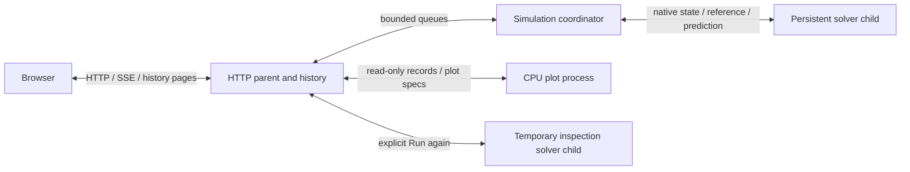

# Architecture and continuation guide

The application is a local simulation and inspection diagnostic. It imports
`tiago_mpc` physics/controller code unchanged and owns browser interaction,
execution scheduling and retained history. Read [AGENTS.md](../AGENTS.md) for
project constraints and [the glossary](../UBIQUITOUS_LANGUAGE.md) for domain terms.
[README.md](../README.md) contains startup, prepared-environment/source selection,
cache/build policy and user workflows.

## Process ownership



`server.py` wires the services. The HTTP parent drains numerical output and
retains every committed record before publishing latest-value notices. It also
renders FK for those records; it owns no live controller/CUDA objects. The
simulation coordinator owns native plant state/time, integration and GPU leases.
Its persistent solver child owns the upstream controller and private warm state
using the selected profile's interpreter. Normal solves reuse that child.
CPU plotting loads committed sources independently. Explicit Run again pauses
Live at a committed boundary and uses a separate temporary solver child; only
one GPU computation runs at a time. Live's private controller remains idle.

## Where to change what

| Area | Main source files | Contract |
| --- | --- | --- |
| HTTP, scene/model/FK, service wiring | [server.py](../server.py) | [Live payloads](live-api.md) |
| History, generations, SSE publication | [execution_bridge.py](../execution_bridge.py), [execution_worker.py](../execution_worker.py) | [Execution/history](execution-api.md), [reporting](presentation.md) |
| Simulation clocks, held torque, interval costs | [execution_session.py](../execution_session.py), [solver_adapter.py](../solver_adapter.py) | [Execution](execution-api.md) |
| Upstream imports, config, reference geometry, synchronous adapter | [live_mpc.py](../live_mpc.py) | [Live settings/tasks](live-api.md) |
| Solver RPC, native conversion, leases, child lifetime | [solver_process.py](../solver_process.py), [solver_worker.py](../solver_worker.py), [solver_lifecycle.py](../solver_lifecycle.py) | [Solver profiles](solver-profiles.md) |
| Source/interpreter/cache discovery and explicit builds | [source_runtime.py](../source_runtime.py), [source_settings.py](../source_settings.py), [visualizer_config.py](../visualizer_config.py), [scripts/source_probe.py](../scripts/source_probe.py) | [README source setup](../README.md#run) |
| Run again, exact captured problem, binary SQP trace | [solve_inspections.py](../solve_inspections.py), [inspection_problem.py](../inspection_problem.py), [inspection_worker.py](../inspection_worker.py), [inspection_artifacts.py](../inspection_artifacts.py) | [Inspection](inspection.md) |
| Plot jobs, source views, standard plots | [plot_service.py](../plot_service.py), [plot_sources.py](../plot_sources.py), [gato_visualizer/plotting/](../gato_visualizer/plotting), [plotters/standard.py](../plotters/standard.py) | [Plot API](plot-api.md), [author workflow](plot-authoring.md) |
| NPZ validation, watched library, uploads | [replay_format.py](../replay_format.py), [replay_library.py](../replay_library.py) | [Replay/export cookbook](replay-format.md) |
| Browser scene and interaction wiring | [src/main.js](../src/main.js), [src/workbench-ui.js](../src/workbench-ui.js) | [README workspace](../README.md#workspace) |
| Browser Live history, playback, settings | [src/live.js](../src/live.js), [src/live-history.js](../src/live-history.js), [src/live-execution.js](../src/live-execution.js), [src/presentation-settings.js](../src/presentation-settings.js) | [Execution](execution-api.md), [presentation](presentation.md) |
| Episode/Solve selection and shared plot rendering | [src/plot-inspection.js](../src/plot-inspection.js), [src/plot-state.js](../src/plot-state.js), [src/solve-run.js](../src/solve-run.js), [src/plot-renderer.js](../src/plot-renderer.js) | [Inspection](inspection.md), [plotting](plotting.md) |

`MPCAdapter.solve/advance` retains the synchronous compatibility path used by
`scripts/check_conformance.py`; production Live uses `SimulatorAdapter` and
`MultirateSession`. `LatestPresentation` and `src/live-playout.js` retain older
presentation helpers; the current motion clock is `createHistoryClock` in
`src/live-execution.js`, driven by fetched history. Do not infer production
ownership or playback timing from an old helper alone.

## Invariants to preserve

Simulation, control and TO frequencies are independent of prediction knot
spacing and wall-clock report frequency. At coincident numerical boundaries,
solve first, select the control, then integrate. Every integration endpoint,
control change, plan and completed deadline interval is retained. A slow solve
slows wall-clock progress; it does not advance plant time. Live defaults to
20 Hz reports, a 200 ms simulation-time playback buffer and sample hold.
Changing these presentation preferences does not reset settings, generation or
controller state. See [presentation.md](presentation.md) for packet/page limits.

Native q/v/u crosses the ordinary solver RPC boundary; joint-6 conversion
happens once inside the solver boundary. Packed stages contain N−1 q/v/u knots
and one terminal q/v knot, with no terminal torque. Legacy raw XU and inspection
arrays retain their own signs; portable NPZ already contains native coordinates.
All displayed positions use the full robot root frame derived from the URDF.
The simulator’s independent friction switch selects the source's `plant_step` (stick/slip Coulomb with implicit viscous damping where available, else hard-sign/viscous `plant_rk4`) or loss-free `reach_sim.rk4`; predictor/profile changes do not replace the plant. The separate predictor switch selects a qualified smooth-friction module with runtime tanh width. See [friction](friction.md) for defaults and provenance.

A generation identifies active history, a settings version identifies the
accepted settings, and cancellation revision rejects obsolete work. Changing
execution settings captures displayed q, qd and task time once for a new segment.
Ordinary Play extends the history tip. Pinning fixes solve/iteration selection;
it does not pause the episode. Exact optimizer continuation is unavailable.
Run again is cold, separate and explicit; inspection Stop terminates only its
isolated child and supplies no partial checkpoint. Ordinary Pause is cooperative.

Saved source/interpreter/cache selection controls imports. Source Apply restarts
the backend; profile activation replaces only the solver and starts a new segment.
Neither ordinary settings nor profile activation compiles. Build selected N is
the explicit build path, reusing the selected project cache. Logs, binary traces
and local history belong in this checkout's ignored `_expr_data/`; the shared
ingest directory contains portable replay handoffs only. See AGENTS for storage
exceptions and preservation rules.

## Verification

Choose existing checks for the area changed; documentation-only changes need
link/contract review, not GPU runs. From the checkout root, resolve the prepared
interpreter without installing packages:

```bash
python_bin="$(python3 scripts/launch_python.py)"
```

| Change | Focused CPU/browser checks |
| --- | --- |
| Scheduling, anchors, cancellation | `"$python_bin" -m unittest discover -s tests -p 'test_execution.py' -v` |
| Reporting and presentation preferences | `"$python_bin" -m unittest discover -s tests -p 'test_record_batching.py' -v`; `"$python_bin" -m unittest discover -s tests -p 'test_presentation_settings.py' -v` |
| History storage, cursors and HTTP | `"$python_bin" -m unittest discover -s tests -p 'test_history*.py' -v` |
| Solver boundary and profile lifecycle | `"$python_bin" -m unittest discover -s tests -p 'test_solver*.py' -v` |
| Inspection problem/capture/jobs | `"$python_bin" -m unittest discover -s tests -p 'test_*inspection*.py' -v` |
| Source selection/build orchestration | `"$python_bin" -m unittest discover -s tests -p 'test_source*.py' -v` |
| Plot functions, jobs and views | `"$python_bin" -m unittest discover -s tests -p 'test_plot*.py' -v`; [offline CLI checks](plot-authoring.md#offline-checks) |
| Replay validation and export compatibility | `"$python_bin" -m unittest discover -s tests -p 'test_replays.py' -v` |
| Browser logic and bundle | `npm test`; `npm run build` (or `node --test src/live-execution.test.js src/presentation-settings.test.js` for focused playback checks) |

The full CPU suite is `"$python_bin" -m unittest discover -s tests -v`. Model and
replay tests expect a prepared sibling `../tiago_mpc_vis_baseline` and its exporter; fake
adapters exercise process/scheduler behavior without proving native solver
numerics. The opt-in [GPU conformance command](../README.md#development) covers
the synchronous adapter only. Native/profile qualifications are bounded by the
actual source, model and horizon checked; no CPU suite establishes all-horizon
GPU equivalence or performance. Retain new native evidence under `_expr_data/`
and coordinate an idle GPU window when such work is authorized and relevant.

## Accepted decisions and limits

- [ADR 001: reuse upstream numerics; own execution clocks](adr/001-upstream-and-clocks.md).
- [ADR 002: isolate solver state and explicit inspection](adr/002-solver-isolation.md).
- [ADR 003: retain all numerical history; batch presentation](adr/003-history-and-presentation.md).

The prototype provides simulated motion, no physical-robot command or collision
qualification, and diagnostic timings rather than benchmark evidence. History
files survive replacement, but there is no historical-generation/branch browser.
Ordinary solves do not retain full incoming optimizer state or intermediate
trajectory traces; missing historical data stays unavailable. These limits are
part of the current contract, not implicit permission to expand scientific scope.
